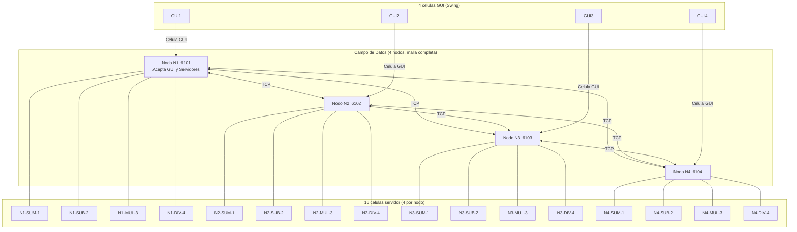

# Calculadora Distribuida ADS — Campo de Datos en Malla Completa

**Asignatura:** Cómputo Distribuido (9no Semestre — LIDCI21)  
**Institución:** Universidad Panamericana, Campus Ciudad de México  
**Profesor:** Dr. Carlos Pérez Leguízamo  
**Estudiante:** Javier Rangel  
**Parcial:** Segundo (entrega y examen 23-Oct-2026 según calendario del curso; fecha no confirmada en PDF oficial)  

Calculadora aritmética distribuida ($+$, $-$, $\times$, $\div$) construida sobre una **arquitectura ADS** (*Autonomous Decentralized Systems*): nodos TCP iguales que forman un **Campo de Datos** en **malla completa**, conectados a **células GUI** y a **células servidor** configuradas por servicio. El *broadcast* entre nodos propaga solicitudes y respuestas con **Códigos de Contenido**; ningún coordinador central es indispensable.



---

## 📋 Descripción

- **Ruta principal**: paquete `mx.edu.up.computing.ads` con tres tipos de programas (**nodo**, **célula servidor**, **célula cliente GUI**) más una utilidad de demo y un *smoke test*.
- **Malla completa**: cada nodo abre un `ServerSocket` propio y se enlaza a los demás por la lista `--peers`, sin orden de partida ni seed obligatorio.
- **Células servidor configurables**: una sola operación por instancia (`SUM`, `SUB`, `MUL`, `DIV`); cuatro instancias por servicio en la demo y cuatro GUI, **20 células en total** sobre **4 nodos**.
- **Escalabilidad**: las cantidades 4/4/16 son el mínimo del demo. Los programas no codifican ese tamaño: cualquier número de nodos y células es válido mientras se conserve la convención de IDs únicos de instancia.
- **Sin middleware central**: no se reutiliza el coordinador TCP del primer parcial. La caída de un nodo no detiene a los demás; las células reintentan su mismo endpoint. Cambiar a otro nodo exige editar host/puerto en la GUI y conectar, o reiniciar el programa con otro endpoint. No hay migración automática ni reasignación de solicitudes en vuelo.

> ℹ️ **Nota sobre prácticas de clase:** la carpeta `practicas-curso/` contiene ejercicios y talleres prácticos del aula (mallas P2P en Python). No forma parte de este proyecto y no debe considerarse para su evaluación. **No se modifica**.

---

## 📦 Requisitos

| Componente | Versión |
| :--- | :--- |
| JDK | **21 LTS mínimo** (`<maven.compiler.release>21` en `pom.xml`); verificado en macOS con OpenJDK 26.0.2.1 vía Homebrew |
| Apache Maven | **3.9+** (sólo necesario si debe regenerarse el *Fat JAR*; `mvn -v` muestra JDK real usado) |
| SO | macOS, Linux o Windows con entorno gráfico (la demo **construye** siempre las 4 GUI Swing; sólo se hacen **visibles** con `--gui`) |
| Red local | Seis enlaces TCP entre los cuatro nodos en malla completa (puertos `6101`–`6104` en localhost) |

> **Distinguir requisito JDK vs *stub* de `command -v`.** En macOS con Homebrew, `/usr/bin/java` puede ser un *stub* (`Unable to locate a Java Runtime`) que NO apunta a un JDK real. Verificá con `java -version`: si falla, exportá `JAVA_HOME` y `PATH` antes de correr el lanzador.

### Setup recomendado (macOS + Homebrew openjdk)

```bash
# Si instalaste openjdk@21 (no mezclar con openjdk@26):
export JAVA_HOME="$(brew --prefix openjdk@21)"

# Si instalaste openjdk (la más reciente, p. ej. 26.0.2.1):
export JAVA_HOME="$(brew --prefix openjdk)/libexec/openjdk.jdk/Contents/Home"

export PATH="$JAVA_HOME/bin:$PATH"

java -version     # debe reportar el JDK real
mvn --version     # debe listar el mismo Java home arriba
```

Setup equivalente en Linux/Windows (ajustar rutas). El lanzador (`run-ads-demo.sh` / `run-ads-demo.ps1`) **respeta** `JAVA_HOME` y `PATH` ya configurados; no instala ni hace *symlink* global. Si `command -v java` resuelve a un *stub* sin JDK real, la verificación de prereq del lanzador fallará con `[ERROR] Java no está en el PATH.`

Verificación rápida desde el repo:

```bash
java -version
mvn --version
```

---

## 🛠 Compilación y Empaquetado

```bash
cd distributed-computing

# Genera target/distributed-computing-1.0.0-jar-with-dependencies.jar
mvn clean package
```

El artefacto ejecutable queda en:

```
target/distributed-computing-1.0.0-jar-with-dependencies.jar
```

El `pom.xml` mantiene `maven.compiler.release=21`, Gson 2.11 y FlatLaf 3.5.4; **no añade frameworks nuevos**.

---

## 🚀 Programas del paquete `mx.edu.up.computing.ads`

Todos los `main` se invocan con `java -cp <jar>`. Las firmas exactas están fijadas en `docs/ADS.md`. Ejemplos para la topología 4/4/16:

### 1. Nodo del Campo de Datos (`NodeMain`)

```bash
N=4  # numero de nodos en la demo

# Construir la lista de pares excluyendo el propio. Para N=4, un peer por linea:
declare -a PEERS=(N2@127.0.0.1:6102 N3@127.0.0.1:6103 N4@127.0.0.1:6104)
PEER_LIST=$(IFS=, ; echo "${PEERS[*]}")

java -cp target/distributed-computing-1.0.0-jar-with-dependencies.jar \
  mx.edu.up.computing.ads.NodeMain \
  --id N1 --port 6101 --peers "$PEER_LIST"

# Los restantes nodos solo cambian --id, --port y la lista --peers resultante.
```

- `--peers` es una **lista variable** de `ID@host:port` separadas por coma. Cada nodo abre **una conexión saliente por par** (`AdsNode.dialPeerLoop`); si el par también lo diala, gana el `putIfAbsent` y el competidor se descarta silenciosamente (`PEER_DUP`). No hay ordenamiento canónico previo: todos los pares configurados se dialan en paralelo.

### 2. Célula servidor (`ServerMain`)

Una célula por proceso. Configurable para un único servicio (`SUM`, `SUB`, `MUL`, `DIV`):

```bash
java -cp target/distributed-computing-1.0.0-jar-with-dependencies.jar \
  mx.edu.up.computing.ads.ServerMain \
  --id N1-SUM-1 --service SUM --host 127.0.0.1 --port 6101
```

Por nodo se levantan cuatro células: `--service SUM`, `--service SUB`, `--service MUL`, `--service DIV` con IDs únicos de instancia (formato `<nodeId>-<service>-<n>`; ej. `N1-SUM-1`, `N1-SUB-1`, `N1-MUL-1`, `N1-DIV-1`). El `deriveNodeId()` del servidor devuelve el prefijo antes del primer `-`, por lo que `N1-SUM-1` produce `N1` (el nodo lógico). Cuatro nodos × cuatro servicios = **16 células servidor**.

### 3. Célula cliente GUI (`ClientMain`)

```bash
java -cp target/distributed-computing-1.0.0-jar-with-dependencies.jar \
  mx.edu.up.computing.ads.ClientMain \
  --id GUI1 --host 127.0.0.1 --port 6101
```

Cuatro GUI: `GUI1`, `GUI2`, `GUI3`, `GUI4`. La GUI nunca calcula; delega en el servidor elegido desde el broadcast de anuncios.

### 4. Demo completa (`DemoMain`)

Levanta la **topología mínima del PDF (pp. 2)**: `nodes` nodos en malla completa, una GUI por nodo y cuatro servidores por nodo (uno por servicio). Por defecto son 4 nodos, base de puertos 6101, GUI no visibles y `bounded shutdown` de 5 s. **No usa argumentos posicionales** — admite flags con `--`:

```bash
# Demo minima, sin ventanas Swing (verificacion rapida por consola)
java -cp target/distributed-computing-1.0.0-jar-with-dependencies.jar \
  mx.edu.up.computing.ads.DemoMain

# Demo grafica: hace visibles las GUI Swing (requiere servidor X / Windows / macOS nativo)
java -cp target/distributed-computing-1.0.0-jar-with-dependencies.jar \
  mx.edu.up.computing.ads.DemoMain --gui

# Topologia personalizada (5 nodos, base 7101, ventanas Swing visibles)
java -cp target/distributed-computing-1.0.0-jar-with-dependencies.jar \
  mx.edu.up.computing.ads.DemoMain --nodes 5 --base 7101 --gui

# Limite explicito para el apagado ordenado
java -cp target/distributed-computing-1.0.0-jar-with-dependencies.jar \
  mx.edu.up.computing.ads.DemoMain --bounded-ms 8000
```

Flags disponibles según `DemoMain.parse`:

- `--base <int>` — primer puerto de la malla (default `6101`).
- `--nodes <int>` — número de nodos en malla completa (default `4`).
- `--gui` — hace visibles las GUI Swing. Sin este flag la demo corre **headless** (clientes construidos pero sin ventana); recomendado para CI.
- `--bounded-ms <long>` — cota en milisegundos para el apagado ordenado al recibir `SIGTERM`/`SIGINT` (default `5000`).

`DemoMain` ofrece la ruta recomendada para grabar el video cuando se ejecuta con `--gui` y la red interna con la opción visible. Sin `--gui`, sirve para validar conectividad de nodos y servidores por consola.

### 5. *Smoke test* (`SmokeMain`)

Corre la **misma topología mínima (4 nodos / 4 GUI / 16 servidores)** sobre sockets reales, ejercita las cuatro operaciones desde cada GUI y espera respuesta única correlacionada. Sin `--gui` no abre ventanas Swing; con `--gui` controla las ventanas por `Robot` y, opcionalmente, captura screenshots sólo de las ventanas ADS en `logs/ads-screens/`.

```bash
# Smoke headless (cobertura de red sin ventanas)
java -cp target/distributed-computing-1.0.0-jar-with-dependencies.jar \
  mx.edu.up.computing.ads.SmokeMain

# Smoke con ventanas Swing controladas por Robot
java -cp target/distributed-computing-1.0.0-jar-with-dependencies.jar \
  mx.edu.up.computing.ads.SmokeMain --gui

# Personalizar puerto base y timeout por respuesta
java -cp target/distributed-computing-1.0.0-jar-with-dependencies.jar \
  mx.edu.up.computing.ads.SmokeMain --base 7201 --timeout-ms 15000
```

Flags vigentes del contrato:

- `--base <int>` — primer puerto de la malla (default `6201` para no chocar con la demo `6101`).
- `--timeout-ms <long>` — *timeout* por respuesta esperada (default `20000`).
- `--gui` — abre las ventanas Swing y opera por `Robot`.
- `--write-screenshot` — guarda capturas de las ventanas ADS en `logs/ads-screens/`.

> El `SmokeMain` valida los seis enlaces de la malla completa y la respuesta única por solicitud entre las cuatro réplicas del mismo servicio. Capturas regenerables: `logs/ads-screens/*.png` (recomendado reejecutar para evidencia); la imagen durable sin metadatos PII está en `docs/evidence/ads-four-guis.png`.

---

## 🎬 Lanzadores incluidos

Ambos lanzadores son **deliberadamente aburridos**: sólo cambian al directorio del repo, verifican que `java` esté en el `PATH` y que el JAR exista, y delegan en `DemoMain` en **primer plano**. **No** registran PID, **no** arman procesos en segundo plano, **no** escriben historiales, **no** borran archivos, **no** instalan nada.

La parada es `Ctrl+C`; `DemoMain` tiene un *shutdown hook* acotado (`--bounded-ms`) que apaga servidores, clientes y nodos ordenadamente. **Todo argumento que pasas al lanzador se reenvía tal cual a `DemoMain`.**

| Lanzador | SO | Comportamiento |
| :--- | :--- | :--- |
| `run-ads-demo.sh` | macOS / Linux | `cd` al directorio del script, verifica `java` y `JAR`, `exec java -cp JAR DemoMain "$@"`. |
| `run-ads-demo.ps1` | Windows / PowerShell | `Set-Location` al directorio, verifica `java` y `JAR`, `& java` con un *array* (no `Start-Process`). |

Si el JAR falta, los lanzadores imprimen un mensaje claro indicando que se debe correr `mvn package` antes y salen con código de error — no compilan por su cuenta.

Si PowerShell bloquea la ejecución de scripts:

```powershell
Set-ExecutionPolicy -Scope Process -ExecutionPolicy Bypass
.\run-ads-demo.ps1
```

Uso (los flags `--gui`, `--nodes`, `--base`, `--bounded-ms` van directo a `DemoMain`):

```bash
# macOS / Linux: cualquier flag de DemoMain se reenvía con "$@"
./run-ads-demo.sh --gui                # GUI Swing visibles
./run-ads-demo.sh --nodes 5            # 5 nodos en malla completa
./run-ads-demo.sh --base 7101 --gui    # base de puertos 7101

# Windows (PowerShell): params con nombre equivalentes
.\run-ads-demo.ps1 -Gui
.\run-ads-demo.ps1 -Nodes 5
.\run-ads-demo.ps1 -BasePort 7101 -Gui
```

---

## 🧪 Pruebas automatizadas

```bash
mvn test
```

La suite existente del parcial 1 permanece; el paquete ADS añade:

- Difusión entre 4 nodos y 6 enlaces sin ciclos ni duplicados.
- Respuesta única entre 4 réplicas del mismo servicio por solicitud (selección fija desde anuncio).
- Correlación `messageId` ↔ `requestId` y Códigos de Contenido correctos.
- Replay y caducidad (TTL 30 s, *cache* de ID 60 s).
- División entre cero: error correlacionado, sin valores no finitos en el JSON.
- *Cliente tardío, caída de nodo, escalabilidad > 4*: los escenarios viven en `SmokeMain`; ver §5 y el detalle forense de la corrida aceptada en `docs/evidence/ads-four-guis.png`.

Las pruebas no tocan `data/clients/` ni `data/servers/` ajenos al parcial 1; la persistencia ADS vive en `data/ads/`.

---

## 🧭 Topología y Códigos de Contenido (resumen)

La especificación detallada del protocolo, los mensajes JSON línea-a-línea, la regla de **selección de instancia única**, el comportamiento del **TTL/** *cache* de deduplicación y las garantías/límites ante reinicio o partición viven en `docs/ADS.md`. Resumen operativo:

- **Códigos:** `SUM_REQ/SUM_RES`, `SUB_REQ/SUB_RES`, `MUL_REQ/MUL_RES`, `DIV_REQ/DIV_RES`.
- **Campos del sobre** (POJO mutable `AdsMessage`, según `AdsMessage.java`; **todos opcionales**, `null` permitido — el conjunto efectivo depende del `type` y de la etapa del ciclo de vida): `type`, `messageId` (UUID completo), `requestId` (UUID de la solicitud en respuestas), `contentCode`, `originId`, `clientId`, `senderId`, `senderRole`, `targetServerId`, `service`, `instanceId`, `nodeId`, `host`, `port`, `operandA`, `operandB`, `result`, `status`, `error`, `createdAt`, `expiresAt` (enteros **milisegundos epoch UTC**, no ISO-8601), `hopCount` (contador de saltos, observabilidad). Cada respuesta crea su propio `messageId`.
- **Tipos de mensaje del runtime** (enum `AdsMessageType`): `HELLO_NODE`, `HELLO_GUI`, `HELLO_SERVER`, `HELLO_ACK`, `ADVERTISE`, `SUM_REQ/SUB_REQ/MUL_REQ/DIV_REQ`, `SUM_RES/SUB_RES/MUL_RES/DIV_RES`, `GOODBYE`, `ERROR`. **No** existe un `HELLO` genérico con campo `role`: el rol va implícito en el tipo (`HELLO_NODE` vs `HELLO_GUI` vs `HELLO_SERVER`). `HELLO_ACK` es la confirmación del receptor.
- **Anuncios:** cada servidor emite su presencia cada **2 s** con **lease de 6 s**; los nodos la difunden por la malla hasta sus GUI.
- **Vida del mensaje:** **30 s** desde `createdAt`; expiración inmutable en cada salto. *Cache* atómica de IDs procesada durante **60 s** desde la primera recepción. Cualquier entrega tardía del mismo `messageId` ya fue expulsada.
- **Una sola respuesta — comunicación por contenido + arbitraje de ejecución.** Todo `*_REQ`/`*_RES` viaja por **broadcast** en la malla completa; los **nodos retransmiten sin filtrar por `targetServerId`** (no es una ruta). Cada célula servidor **observa** el mensaje al recibirlo: si su `service` y su `instanceId == targetServerId`, ejecuta (`COMPUTE` → `RESPONSE`); en caso contrario registra `IGNORE_TARGET` o `IGNORE_SERVICE` sin responder. Esta estrategia preserva la observación universal de la comunicación por contenido y concentra la unicidad de respuesta en la célula tras observar el Código de Contenido. Sus implicaciones y alternativas se detallan en `docs/ADS.md` §13.
- **Timeout de operación:** **10 s** en la GUI. Una operación agotada **no** se reasigna automáticamente: el cliente decide si lanza una nueva con `messageId` nuevo y `targetServerId` quizá distinto.
- **No** se promete *exactly-once* durable bajo reinicio o partición. La caída de un nodo se detecta por EOF en las células que lo apuntaban; las GUI y servidores **no** migran a otro par automáticamente — reintentan el mismo endpoint con back-off `1.5 s → 10 s` cap (`AdsConstants.PEER_RECONNECT_MS`, duplicado por fallo). La respuesta en vuelo se pierde y la GUI recibe timeout a los 10 s.

---

## 🗂 Estructura del repositorio

```
distributed-computing/
├── README.md                    ← este archivo (rutas ADS)
├── docs/
│   └── ADS.md                   ← especificación del protocolo ADS
├── src/
│   ├── main/java/mx/edu/up/computing/
│   │   ├── common/              ← parcial 1 (NetworkMessage, JsonCodec, ...)
│   │   ├── client/              ← parcial 1 (ClientMain, CalculatorUi)
│   │   ├── server/              ← parcial 1 (ServerMain, ComputeServer, CalculatorEngine)
│   │   ├── middleware/          ← parcial 1 (MiddlewareMain, ...)
│   │   └── ads/                 ← segundo parcial (NodeMain, ServerMain, ClientMain, DemoMain, SmokeMain)
│   └── test/java/mx/edu/up/computing/
│       ├── DistributedCalculatorTest.java   ← parcial 1
│       └── ads/                              ← cobertura ADS
├── data/                        ← historiales parcial 1 (intactos)
│   ├── clients/                 ← Client-1_history.json, Client-2_history.json, ...
│   ├── servers/                 ← Server-1_history.json, Server-2_history.json, ...
│   └── ads/                     ← historiales ADS nuevos (separados)
├── practicas-curso/             ← prácticas de clase (NO se modifica)
├── pom.xml
├── run-ads-demo.sh              ← lanzador ADS POSIX
├── run-ads-demo.ps1             ← lanzador ADS PowerShell
└── run-demo-cluster.sh / .ps1   ← lanzadores históricos parcial 1 (preservados)
```

---

## 📜 Histórico Primer Parcial (acceso, no ruta principal)

El primer parcial conserva su propio stack y lanzadores, invocables sin tocar ADS:

- **Código**: `mx.edu.up.computing.{client,middleware,server,common}` bajo `src/main/java`.
- **Lanzadores POSIX**: `run-demo-cluster.sh`, `run-demo-terminals.sh`, `run-client.sh`, `run-server.sh`, `run-middleware.sh`.
- **Lanzador Windows**: `run-demo-cluster.ps1`.

Para ejecutar la calculadora de tres capas:

```bash
# Construye el JAR si falta y arranca middleware + 2 servidores + 2 clientes GUI
./run-demo-cluster.sh

# Detener
./run-demo-cluster.sh --stop
```

Esta ruta no utiliza el Campo de Datos; sigue siendo válida como entrega independiente del primer parcial.

---

## 📄 Licencia y entrega

Proyecto desarrollado para el Segundo Parcial de Cómputo Distribuido, Universidad Panamericana (2026). El primer parcial se conserva como entregable histórico independiente; las prácticas de clase viven en `practicas-curso/` y no forman parte de la evaluación del proyecto.
