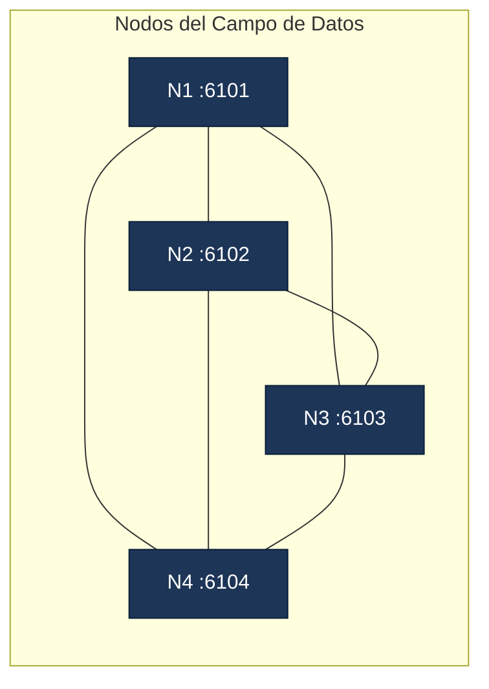

# ADS — Especificación del Campo de Datos y Protocolo

> Documento canónico del **proyecto del Segundo Parcial de Cómputo Distribuido**. Describe arquitectura, mensajes JSON, reglas de selección de instancia, deduplicación, TTL/lease y límites del sistema. El contrato operativo se complementa con `docs/PLAN-PARCIAL2.md` (brief acordado).

## Índice

1. [Alcance y diferencias con el parcial 1](#1-alcance)
2. [Topología y malla completa](#2-topologia)
3. [Roles y puntos de entrada](#3-roles)
4. [Formato del mensaje](#4-formato)
5. [Handshake `HELLO_*` y descubrimiento](#5-hello)
6. [Anuncios de servicio y selección de instancia](#6-anuncios)
7. [Solicitudes y respuestas (`*_REQ` / `*_RES`)](#7-solicitudes)
8. [Deduplicación, TTL y *cache* de IDs](#8-deduplicacion)
9. [Trazas y bitácora](#9-trazas)
10. [Persistencia ADS](#10-persistencia)
11. [Tiempos, *timeouts* y garantías](#11-tiempos)
12. [Particiones, reinicios y recuperación](#12-particiones)
13. [Decisión del equipo y *tradeoffs*](#13-decision)
14. [Catálogo de códigos y campos](#14-codigos)

---

<a id="1-alcance"></a>
## 1. Alcance y diferencias con el parcial 1

| Aspecto | Primer parcial | Segundo parcial (ADS) |
| :--- | :--- | :--- |
| Arquitectura | 3 capas con middleware central | Campo de Datos en malla completa (sin SPOF) |
| Programa cliente | GUI cliente pesado Swing | Célula cliente GUI Swing |
| Programa servidor | Servidor de las 4 operaciones | Célula servidor configurable para **un solo servicio** (`SUM`/`SUB`/`MUL`/`DIV`) |
| Programa intermedio | Middleware TCP | Nodo del Campo de Datos (enrutador/retransmisor por *broadcast*) |
| Difusión | Coordinada por el middleware | *Broadcast* entre nodos por malla completa; Códigos de Contenido |
| Demostración mínima | 1 middleware + 2 servidores + 2 GUI | **4 nodos + 4 GUI + 16 servidores (20 células)** |
| Escalabilidad | Cantidades cableadas a la demo | Las cantidades de la demo son el **mínimo demostrable**, no constantes del programa |
| Garantía | Difusión bilateral del middleware | Una respuesta por solicitud entre 4 réplicas; sin reasignación automática en vuelo |

> Ambos parciales conviven en el repositorio. La ruta ADS (`mx.edu.up.computing.ads`) **no** reutiliza el middleware del primer parcial como coordinador.

---

<a id="2-topologia"></a>
## 2. Topología y malla completa

La demo exigida por el PDF del profesor es **4 nodos en malla completa**: cada nodo se conecta directamente a los otros tres (6 enlaces), acepta una GUI y cuatro células servidor (4 servicios), totalizando **4 GUI + 16 servidores = 20 células**.



> **Escalabilidad.** Los nodos descubren nuevos pares con solo actualizar la lista `--peers`; el código **no** codifica el número `4`. Cualquier $N \ge 2$ opera, conservando la unicidad de IDs de instancia.

---

<a id="3-roles"></a>
## 3. Roles y puntos de entrada

Todos los `main` viven en `mx.edu.up.computing.ads`. Sus **firmas exactas** se reproducen aquí según el código revisado; cualquier adición o cambio en runtime exige actualizar este apartado.

### 3.1 Nodo del Campo de Datos (`NodeMain`)

```
java mx.edu.up.computing.ads.NodeMain --id N1 --port 6101 \
     --peers N2@127.0.0.1:6102,N3@127.0.0.1:6103,N4@127.0.0.1:6104
```

Flags efectivos (sin alias cortos oficiales más allá de `-p` para `--port`):

- `--id <string>` — identificador lógico del nodo (default `N1`).
- `--port <int>` / `-p <int>` — puerto TCP en el que escucha (default `6101`).
- `--peers <lista>` — lista `ID@host:puerto` separada por coma. Cada elemento es un par de la malla; el nodo diala **todos los pares en paralelo** (`AdsNode.dialPeerLoop`, back-off inicial `PEER_RECONNECT_MS = 1500 ms`, doble por fallo, tope `10000 ms`). La dirección canónica se decide por `AdsDirection`:
  - si `nodeId.compareTo(peerId) < 0` (yo soy el menor) → **prefiero `OUTBOUND`** (mi dial).
  - si `nodeId.compareTo(peerId) > 0` (yo soy el mayor) → **prefiero `INBOUND`** (acepto el dial del menor).
  - **Late join unilateral:** si un canal llega en dirección no-preferida y NO existe el preferido, **se acepta** (no se descarta un canal vivo); si llega con la preferida, **reemplaza** la existente; si llega con la no-preferida y ya existe la preferida, **se cierra** la nueva (`PEER_REJECTED`).
  - El competidor que pierde el desempate se cierra silenciosamente (`PEER_DUP`).
  - El programa **no** descubre nodos automáticamente: la topología es estática y se reconstruye mediante los pares configurados.
- El proceso queda vivo leyendo de `stdin` los comandos interactivos `status`, `peers`, `cells`, `dedup`, `quit`.

### 3.2 Célula servidor (`ServerMain`)

```
java mx.edu.up.computing.ads.ServerMain --id N1-SUM-1 --service SUM \
     --host 127.0.0.1 --port 6101
```

Flags efectivos:

- `--id <string>` / `-i <string>` — identificador lógico. Convención del demo: `<nodeId>-<service>-<n>` (ej. `N1-SUM-1`, `N1-SUB-1`, `N1-MUL-1`, `N1-DIV-1`). El prefijo antes del primer `-` lo usa `deriveNodeId()` para fijar el campo `nodeId` del HELLO_SERVER/ADVERTISE (es decir, el id lógico del nodo al que la célula se conecta).
- `--service <SUM|SUB|MUL|DIV>` / `-s <…>` — **obligatorio**; configuración única de la célula (exit code `2` si falta).
- `--host <string>` / `-h <string>` — host del nodo (default `127.0.0.1`).
- `--port <int>` / `-p <int>` — puerto del nodo (default `6101`).
- El `instanceId` (UUID) se asigna internamente en el constructor: cada arranque produce un UUID nuevo, de modo que dos servidores con el mismo `--id` siguen siendo instancias distinguibles en la malla.

### 3.3 Célula cliente GUI (`ClientMain`)

```
java mx.edu.up.computing.ads.ClientMain --id GUI1 --host 127.0.0.1 --port 6101
```

Flags efectivos:

- `--id <string>` / `-i <string>` — identificador lógico de la GUI (default `GUI1`).
- `--host <string>` / `-h <string>` — host del nodo inicial.
- `--port <int>` / `-p <int>` — puerto del nodo inicial.
- El `instanceId` (UUID) se asigna en el constructor (`UUID.randomUUID()`).
- La GUI Swing se hace visible en el EDT (`SwingUtilities.invokeLater`) — al arrancar sale la ventana; no existe modo headless con este `main`.

### 3.4 Demo completa (`DemoMain`)

```
java mx.edu.up.computing.ads.DemoMain [--base 6101] [--nodes 4] [--gui] [--bounded-ms 5000]
```

**No usa argumentos posicionales**. Internamente: topología mínima por defecto — `nodes` nodos en malla completa, una GUI por nodo y cuatro servidores por nodo (uno por servicio). Flags efectivos:

- `--base <int>` — primer puerto de la malla (default `6101`).
- `--nodes <int>` — número de nodos en malla completa (default `4`).
- `--gui` — si está presente, las GUI Swing se construyen **y se hacen visibles**. Sin este flag la demo corre headless: las células GUI existen pero sus ventanas no se muestran; recomendado para CI.
- `--bounded-ms <long>` — cota (ms) para el apagado ordenado al recibir `SIGTERM`/`SIGINT` (default `5000`).

El proceso principal queda vivo hasta señal; `Ctrl+C` activa el *shutdown hook* que apaga servidores, clientes y nodos con la cota indicada.

### 3.5 *Smoke test* (`SmokeMain`)

```
java mx.edu.up.computing.ads.SmokeMain [--gui] [--write-screenshot] \
     [--base 6201] [--timeout-ms 20000]
```

**No usa `--nodes` aquí** — la topología del smoke es fija: 4 nodos en malla completa, 4 GUI, 16 servidores. Flags efectivos del contrato:

- `--base <int>` — primer puerto de la malla. Si se omite, `pickFreePort()` selecciona uno libre; revisar también los puertos consecutivos si se elige explícitamente.
- `--timeout-ms <long>` — *timeout* por respuesta esperada (default `20000`).
- `--gui` — abre las ventanas Swing y opera por `Robot`.
- `--write-screenshot` — guarda capturas de las ventanas ADS en `logs/ads-screens/` (regenerables, no se versionan).

#### 3.5.1 Verificación ejecutada el 13 de octubre de 2026

**Build:** JDK 26, bytecode `release=21`, macOS ARM64; `mvn package` terminó a las 11:17:02 CDMX con 19 pruebas, cero fallos, errores u omisiones.

**Smoke con GUI:** `SmokeMain --gui --write-screenshot`, 11:17:40–11:18:10, salida natural 0 en 31.92 s. Es **una JVM con 24 entidades lógicas**, no 24 procesos:

- Cuatro nodos, seis enlaces canónicos, cuatro GUI y dieciséis servidores.
- Dieciséis solicitudes iniciales (cuatro servicios por cuatro clientes), exactamente dieciséis cómputos globales; correlación por UUID, servicio, código y ejecutor fijado antes de enviar.
- Cuatro clics reales con `Robot` en cuatro ventanas Swing: `SUM=10+5=15`, nueva fila y aceptación del UUID completo. La tabla muestra prefijos de ocho caracteres.
- Replay TCP del mismo sobre en el mismo socket, N1→NA: un cómputo, sin que aumente el contador de duplicados del servidor; el nodo bloquea el replay. Un sobre vencido aumenta el contador de expiración del nodo.
- Alta tardía en N5: descubrimiento de UUID de instancia distintos para los cuatro servicios. No se mide una cota de descubrimiento menor a dos segundos.
- Se detiene N4 y se espera la caducidad del lease de seis segundos; otra suma devuelve 100. GUI1 se desconecta y reconecta; otra suma devuelve 24.
- Al detener todos los servidores DIV, una solicitud produce exactamente un timeout intencional y ninguna respuesta; no aparecen otros timeouts.
- El cierre de ventanas detiene el `connectionPoller` Swing; `client.disconnect()` cierra socket y ejecutores. El proceso termina sin `System.exit(0)`.

**CLI separado:** cuatro `NodeMain`, dieciséis `ServerMain` y cuatro `ClientMain`, **24 JVM independientes y cuatro ventanas nativas**. Cada nodo informa tres pares y cinco células. La sonda N1→N4 con `10/2` obtiene SUM 12, SUB 8, MUL 20 y DIV 5. `DIV=9/0` devuelve `ERROR_DIVISION_BY_ZERO`, error literal “División entre cero exacta” y correlación conservada.

Tras SIGTERM de N2, una suma nueva N1→N4 devuelve 100. Reiniciando N2 en el mismo puerto, sus cuatro servidores y **GUI2 solamente**, se restauran seis enlaces y aparecen cuatro UUID de servidor nuevos. N1→N2 devuelve `7+6=13`; se relee un registro `eventType=COMPUTE_SUM` con trece campos presentes, sin `error` ni `notes`. Los dos primeros controladores temporales se interrumpieron por aserción equivocada y `NameError` propios; no se presentan como corridas completas. El tercero completó recuperación y lectura JSON. Se cerraron todos los PIDs propios sin `pkill` global.

**Borde numérico por TCP:** `1e308*1e308` devuelve `ERROR_NON_FINITE` sin número JSON inválido; la siguiente `3*4` devuelve 12. Ambos registros se releen. SHA-256 de los cinco archivos locales ajenos coincide con el bootstrap.

La evidencia visual durable, compuesta de las cuatro capturas reales después del clic, está en [ads-four-guis.png](evidence/ads-four-guis.png). Los originales regenerables están en `logs/ads-screens/`. Los historiales temporales del smoke se limpian al terminar. Windows y la grabación humana del video no se han ejecutado.

<a id="4-formato"></a>

## 4. Formato del mensaje

- **Transporte:** UTF-8, una línea por mensaje, terminada en `\n` (LF). El parseo lo hace `AdsMessage.fromJson(line)` (POJO Gson con `disableHtmlEscaping()`); cualquier línea malformada se descarta vía `logger.error("READ_PARSE", …)` y la conexión continúa. **No** se reutiliza `mx.edu.up.computing.common.JsonCodec` del parcial 1.
- **Identidad universal:** `messageId` es **UUID completo** (RFC 4122, 128 bits, hex con guiones) tanto en el original como en cada respuesta. Las respuestas crean un `messageId` propio e incluyen `requestId` igual al `messageId` del `*_REQ` original.
- **Disponibilidad de campos:** ningún campo del sobre es obligatorio en la API de `AdsMessage`; el conjunto efectivo en cada mensaje depende del `type` y de la etapa del ciclo de vida. Ver §4.1.
- **Marca temporal:** `createdAt` y `expiresAt` en milisegundos epoch UTC (entero `long`), no ISO-8601. `expiresAt = createdAt + MESSAGE_TTL_MS` (30 000 ms). El campo `expiresAt` **no se modifica** al retransmitirse (válido en cada salto).
- **Serialización:** Gson (`Gson` 2.11); `Double.NaN` e `Infinity` **nunca** se serializan como números JSON. Errores de división por cero viajan como `status="ERROR_DIVISION_BY_ZERO"` con `result=null`.

### 4.1 Campos del sobre `AdsMessage` (ver `AdsMessage.java`)

| Campo | Tipo | Descripción |
| :--- | :--- | :--- |
| `type` | string | Nombre del enum `AdsMessageType` (ver catálogo en §14). |
| `messageId` | UUID | Identificador único del mensaje. Cada respuesta crea el suyo. |
| `requestId` | UUID | Sólo en respuestas: `messageId` del `*_REQ` original. |
| `contentCode` | string | Refleja la operación: `SUM_REQ`/`SUM_RES`/... (redundante con `type` para observabilidad). |
| `originId` | string | Identificador **lógico** del originador (GUI para `*_REQ`, servidor para `*_RES`). |
| `clientId` | string | GUI que origina la solicitud; se reenvía al cómputo. |
| `senderId` | string | UUID/ID de la célula o nodo que **reenvía** el mensaje en un salto dado (marcador de transporte). |
| `senderRole` | string | Rol del reenvío: `NODE`, `GUI`, `SERVER`. |
| `targetServerId` | string | UUID de la instancia ejecutora elegida; **arbitraje de ejecución**, no ruta. |
| `service` | string | `SUM` / `SUB` / `MUL` / `DIV` (anuncios y filtros). |
| `instanceId` | string | UUID único de la instancia que emitió el mensaje (servidor, GUI). Generado por `UUID.randomUUID()` al arrancar la célula. |
| `nodeId` | string | ID lógico del nodo asociado, derivado del prefijo de `serverId`, por ejemplo `"N2-SUM-1"` → `"N2"`. No es UUID ni una dirección de enrutamiento. |
| `host` | string | Host reportado por la célula (servidor o nodo) en su `ADVERTISE` / `HELLO_NODE` con fines informativos. |
| `port` | integer | Puerto reportado por la célula en su `ADVERTISE` / `HELLO_NODE` con fines informativos. **No** se usa como dirección del socket de la célula para el envío de tráfico: cada célula mantiene una única conexión TCP con su nodo (`--host`/`--port` al arrancar); el GUI **no** rota a "otro par" tras caída, simplemente reintenta el mismo endpoint. |
| `operandA`, `operandB` | number | Operandos de `*_REQ`, copiados también al `*_RES`. |
| `result` | number | Presente en `*_RES` exitoso. Los campos Java nulos se omiten en el JSON, no se emiten como `null`. |
| `status` | string | Valores efectivamente emitidos por `AdsCalculatorEngine`: `SUCCESS`, `ERROR_DIVISION_BY_ZERO`, `ERROR_NON_FINITE`, `ERROR_SERVICE_MISMATCH`, `ERROR_INVALID_INPUT`. **No** existe validación de enum en el cliente: si llega un `status` fuera de ese conjunto, se acepta y se persiste tal cual. |
| `error` | string \| null | Mensaje legible cuando `status != SUCCESS`. |
| `createdAt` | long | **Milisegundos epoch UTC** desde `1970-01-01T00:00:00Z`. Marcado en el origen (`AdsMessage.create`). |
| `expiresAt` | long | **Milisegundos epoch UTC**, `createdAt + MESSAGE_TTL_MS` (30 000 ms). **Inmutable** en cada salto. |
| `hopCount` | int | Contador de saltos (uso observacional; no altera la unicidad lógica). |

---

<a id="5-hello"></a>
## 5. Handshake `HELLO_*` y descubrimiento

El handshake distingue el rol **dentro del `type`** (`AdsMessageType`), no en un campo `role`. Tres tipos específicos más la confirmación:

**`HELLO_NODE`** — `instanceId == nodeId` (el id lógico, **no** un UUID). Lo emite el nodo dialer; el receptor lo usa para correlacionar. `host` y `port` son los del **socket saliente local efímero** (`socket.getLocalAddress().getHostAddress()` y `socket.getLocalPort()`), **no** el puerto de escucha `6101–6104`.

```json
{"type":"HELLO_NODE","messageId":"550e8400-e29b-41d4-a716-446655440000",
 "originId":"N2","instanceId":"N2","senderId":"N2","senderRole":"NODE",
 "host":"127.0.0.1","port":54321,
 "createdAt":1736745669040,"expiresAt":1736745699040}
```

**`HELLO_SERVER`** — `instanceId` es UUID generado al arrancar la célula; `nodeId` deriva de `serverId` (`deriveNodeId()`: prefijo antes del primer `-`; `N1-SUM-1` → `N1`).

```json
{"type":"HELLO_SERVER","messageId":"550e8400-e29b-41d4-a716-446655440001",
 "originId":"N1-SUM-1","instanceId":"a7c1-…","senderId":"a7c1-…","senderRole":"SERVER",
 "nodeId":"N1","service":"SUM",
 "createdAt":1736745669041,"expiresAt":1736745699041}
```

**`HELLO_GUI`** — `instanceId` es UUID.

```json
{"type":"HELLO_GUI","messageId":"550e8400-e29b-41d4-a716-446655440002",
 "originId":"GUI1","instanceId":"12de-…","senderId":"12de-…","senderRole":"GUI",
 "createdAt":1736745669042,"expiresAt":1736745699042}
```

**`HELLO_ACK`** — el receptor responde con `status="SUCCESS"`. **No** lleva `targetServerId` ni `contentCode` (sólo `SUCCESS`); el servidor/GUI no usa esa info para correlacionar.

```json
{"type":"HELLO_ACK","messageId":"550e8400-e29b-41d4-a716-446655440003",
 "originId":"N2","instanceId":"N2","senderId":"N2","senderRole":"NODE",
 "status":"SUCCESS",
 "createdAt":1736745669043,"expiresAt":1736745699043}
```

(`createdAt + 30 000 ms` en todos los HELLO_*; verificado en `AdsMessage.create`.)

- **HELLO no se retransmite.** El switch en `AdsNode.onMessageReceived` filtra `HELLO_NODE/HELLO_GUI/HELLO_SERVER/HELLO_ACK` antes del `forwardEverywhere`: sólo aplican al socket que abrió la conexión.
- **`senderId` no se reescribe por salto.** En `AdsNode.onMessageReceived`, el nodo sólo lo rellena **si viene null** (`if (msg.getSenderId() == null) { msg.setSenderId(sourceId); msg.setSenderRole(sourceRole.name()); }`). Una vez fijado, ningún nodo posterior lo sobrescribe.
- **Adyacencia por cierre TCP, sin heartbeat.** `readLine()` devuelve `null` al recibir EOF o lanza `IOException` ante un error/reset; ambas rutas terminan en `onConnectionClosed`. Se retira el canal propietario y se reintenta el enlace. El lease de un servicio no es un detector de adyacencia.
- **No existe** un `type:"HELLO"` genérico con campo `role`.

---

<a id="6-anuncios"></a>
## 6. Anuncios de servicio y selección de instancia

Cada célula servidor publica el mensaje `ADVERTISE` (tipo único del runtime, **no** un genérico `SERVICE_ANNOUNCE`) cada **2 s**, con **lease de 6 s**:

```json
{"type":"ADVERTISE","messageId":"7c9e6679-7425-40de-944b-e07fc1f90ae7",
 "originId":"N2-SUM-1","instanceId":"a7c10000-0000-4000-8000-000000000001","senderRole":"SERVER",
 "service":"SUM","nodeId":"N2",
 "host":"127.0.0.1","port":6102,
 "createdAt":1736745671000,"expiresAt":1736745677000}
```

- **Cadencia:** emisión cada 2 s, `expiresAt = createdAt + 6 s` (lease propio, no el TTL por defecto del sobre). Ambos timestamps van como enteros **epoch ms**.
- **Nodos: relay puro, sin catálogo.** `AdsNode.onMessageReceived` no catalog ni decrementa TTL de los anuncios; reenvía por `forwardEverywhere` y los nodos no conservan estado de `ADVERTISE`. La retención de candidatos vivos vive **en la GUI** (`AdsAdvertisementRegistry`), no en los nodos.
- **Vista de la GUI (`AdsAdvertisementRegistry.candidatesFor(service)`):** filtra por `expiresAt > now()` y ordena por `instanceId` ascendente (`Comparator.comparing(AdsAdvertisement::instanceId)`). **No** se ordena por latencia ni por `originId` lexicográfico; no existe telemetría de latencia en el runtime actual.
- **Selección del ejecutor:** la GUI toma `candidatesFor(...).get(0)` al construir un `*_REQ` y fija `targetServerId = ad.instanceId()`. La elección es local y exclusiva: el `pending.compute(...)` consume el slot por `requestId` (transición atómica). El emisor conoce la identidad del ejecutor.
- **No** se afirma *descubrimiento automático* de nodos: la topología se construye con `--peers` explícitos. Las **células** (GUI y servidor) mantienen **una única conexión** con el nodo indicado por `--host/--port`; tras EOF reintentan **el mismo endpoint** con back-off 1.5 s → 10 s. **No** rotan a "otro par" automáticamente.
- **Distinción fundamental (PDF pp. 3–4, clases 8–9 — comunicación por contenido):**
  - **Transporte:** todo `*_REQ`/`*_RES` se difunde por la malla completa. Los **nodos retransmiten sin filtrar por `targetServerId`**; el reenvío depende del Código de Contenido y de la topología, no de una dirección lógica.
  - **Observación:** toda célula servidor recibe el mensaje por broadcast; ninguna queda excluida del paso del mensaje.
  - **Arbitraje de ejecución:** cada célula decide localmente, **tras observar el contenido**, si ejecuta. Reglas observables en la traza del runtime (`AdsServer.onMessage`):
    1. Si el mensaje **no** es `*_REQ` válido → se ignora silencioso (anuncios, acks y errores no requieren cómputo).
    2. `serviceOfRequest(t)` (no `contentCode.service`) se compara con el `service` configurado de la célula: si difiere, registra `IGNORE_SERVICE` (`AdsServer.java:247`) y descarta; no responde.
    3. Si `targetServerId != self.instanceId` → registra `IGNORE_TARGET` (`AdsServer.java:254`) y descarta; no responde.
    4. Si ambos coinciden → registra `COMPUTE` (`AdsServer.java:286`), persiste **después** de `connection.send(response)` y emite `*_RES`.
  - `targetServerId` es por tanto **arbitraje de ejecución**, no ruta: identifica *qué instancia concreta* responde, no un camino punto a punto. Es el único punto donde se discrimina el target y nunca se usa como ruta de transporte.
- **Alta tardía:** una instancia que aparece entre anuncio y elección no afecta a operaciones en vuelo; sólo la ven operaciones nuevas desde su primer anuncio. Una que cae desaparece al expirar su lease y la GUI observa la baja en el siguiente *refresh*.

---

<a id="7-solicitudes"></a>
## 7. Solicitudes y respuestas (`*_REQ` / `*_RES`)

### 7.1 Solicitud (`SUM_REQ`)

```json
{"type":"SUM_REQ","messageId":"8d1c4f1a-3b6c-4d2a-9b1e-77f3e2c40ba1",
 "contentCode":"SUM_REQ","originId":"GUI1","clientId":"GUI1",
 "senderId":"12de0000-0000-4000-8000-000000000001","senderRole":"GUI",
 "targetServerId":"a7c10000-0000-4000-8000-000000000001","service":"SUM",
 "operandA":150.0,"operandB":250.0,
 "createdAt":1736745673123,"expiresAt":1736745703123,"hopCount":0}
```

(`expiresAt = createdAt + 30 000 ms` = `AdsConstants.MESSAGE_TTL_MS`; el `senderId` es el UUID `instanceId` de la GUI, no su etiqueta `clientId`.)

- El `messageId` es globalmente único (UUID completo). Es el **identificador de la solicitud** y se usa como `requestId` en la respuesta.
- El `targetServerId` identifica **qué instancia concreta será la ejecutora** de la solicitud. **No** es una dirección de enrutamiento: el mensaje viaja por toda la malla y todas las células lo observan. Sólo la célula cuya `instanceId == targetServerId` ejecuta y emite `*_RES`; las demás lo registran como `IGNORE_TARGET` (si su `service` coincide) o `IGNORE_SERVICE` (si difiere) y no responden. Ver §6 para la separación entre **observación (transporte + contenido)** y **arbitraje de ejecución**.
- La GUI mantiene el pendiente en memoria y registra `REQUEST_SENT` en su historial. Los ejemplos son ilustrativos: sus timestamps históricos ya vencieron y no deben retransmitirse como sobres nuevos; el runtime genera `createdAt` y `expiresAt` al emitir.

### 7.2 Respuesta (`SUM_RES`)

```json
{"type":"SUM_RES","messageId":"9e2d5f2b-4c7d-5e3b-ac2f-88a4f3d51cb2",
 "contentCode":"SUM_RES","originId":"a7c10000-0000-4000-8000-000000000001","clientId":"GUI1",
 "senderId":"a7c10000-0000-4000-8000-000000000001","senderRole":"SERVER",
 "targetServerId":"a7c10000-0000-4000-8000-000000000001","service":"SUM","instanceId":"a7c10000-0000-4000-8000-000000000001",
 "requestId":"8d1c4f1a-3b6c-4d2a-9b1e-77f3e2c40ba1",
 "operandA":150.0,"operandB":250.0,"result":400.0,"status":"SUCCESS",
 "createdAt":1736745673145,"expiresAt":1736745703145,"hopCount":1}
```

> En el runtime (`AdsServer.onMessage`): `originId` de la respuesta es el `instanceId` del servidor emisor (UUID), `clientId` pasa tal cual desde la solicitud, `targetServerId = instanceId` del servidor, `senderId = instanceId`, `senderRole = "SERVER"`.

- `requestId` = `messageId` del `*_REQ` original. Sólo así se acepta la respuesta.
- La GUI acepta **una sola respuesta** por `*_REQ`. El orden de validación en `AdsClient.handleResponse` (`AdsClient.java:262–345`) es:

  1. `msg.isExpired()` → `RESPONSE_EXPIRED` (`AdsClient.java:264`).
  2. `msg.getRequestId()` no nulo (sin evento, sólo `ignoredResponses++`).
  3. `msg.getContentCode()` no nulo → `RESPONSE_NO_CODE` si falta (`AdsClient.java:275`).
  4. `AdsService.fromCode(contentCode)` válido → `RESPONSE_BAD_CODE` si lanza `IllegalArgumentException` (`AdsClient.java:283`).
  5. `targetServerId` y `instanceId` presentes **e iguales** → `RESPONSE_BAD_INSTANCE` si no (`AdsClient.java:289`).
  6. `clientId.equals(msg.getClientId()) || clientId.equals(msg.getOriginId())` → `RESPONSE_BAD_ORIGIN` si no (las respuestas de otras GUI se rechazan aquí, no más tarde; `AdsClient.java:296`).
  7. `msg.getResult() == null || Double.isFinite(msg.getResult())` → `RESPONSE_NON_FINITE` si no (`AdsClient.java:303`).
  8. `pending.compute(rid, …)`: si la entrada no existe, no está completa, el `service` no coincide o el `targetServerId` no es el esperado, se devuelve sin marcar → `RESPONSE_NOT_MATCH` (`AdsClient.java:333`). Si coincide (`existing.service == svc && existing.targetServerId.equals(msg.getTargetServerId())`), marca `completed = true` y acepta.
  9. Sólo entonces se emite `RESPONSE` (`AdsClient.java:338`).

- **Sin validación de `status` como enum.** El cliente acepta cualquier cadena en `status`; los valores que se ven vienen de `AdsCalculatorEngine` (`SUCCESS`, `ERROR_DIVISION_BY_ZERO`, `ERROR_NON_FINITE`, `ERROR_SERVICE_MISMATCH`, `ERROR_INVALID_INPUT`).
- Errores: `DIV_REQ` con `operandB == 0` se responde con `DIV_RES` y `status="ERROR_DIVISION_BY_ZERO"`, `result=null`, `error="..."`. Los operandos **no** se reinterpretan: `NaN`/`±Infinity` se descartan *antes* del cómputo (`AdsCalculatorEngine.STATUS_NON_FINITE`).

### 7.3 `SUB_REQ` / `MUL_REQ` / `DIV_REQ` son análogos, sólo cambian `type`, `contentCode` y `service` en filtros.

---

<a id="8-deduplicacion"></a>
## 8. Deduplicación, TTL y *cache* de IDs

| Parámetro | Valor | Justificación |
| :--- | :--- | :--- |
| `TTL` vida del mensaje | **30 s** | Cubre latencia esperada de la malla + 3 leases de anuncio. |
| `Cache` de IDs retenida | **60 s** desde primera recepción | Ventana 2× TTL para que un *replay* lento quede expulsado. |
| `Lease` de anuncio | **6 s** | 3 ciclos de anuncio (cadencia 2 s) pierden la entrada. |

**Estructura real del dedup (verificada sobre el runtime):**

- **Nodos (`AdsNode`):** `AdsDedup` con `ConcurrentHashMap<String, Long>` (id → `System.currentTimeMillis()` en la primera inserción). `tryRegister(messageId)` con `putIfAbsent`; si ya estaba, devuelve `false` y el nodo emite `DROP_DUPLICATE` (no retransmite). Purga por `AdsNode.housekeep` cada **1 s** con `dedup.purgeExpired()`.
- **Servidores (`AdsServer`):** `seenIds = new ConcurrentHashMap<>()` adicional al del nodo. `purga oportunista` dentro de `onMessage` (`cutoff = now - DEDUP_TTL_MS; entrySet().removeIf(value < cutoff)`), no corre en timer.
- **GUI (`AdsClient`):** `pending` con `ConcurrentHashMap<String, PendingRequest>` (no es dedup de sobre reenviado, sino **de respuesta esperada**). Limpieza sólo al aceptar o al expirar timeout; **no** purga periódica de slots viejos.

**Reglas:**

- `putIfAbsent` atómico: el primer observador avanza; el resto se descarta como `DROP_DUPLICATE`/`IGNORE_DUPLICATE` y **no** retransmite ni ejecuta.
- `isExpired()` (`Instant.now() > expiresAt`) se valida **antes** del filtrado de `service`/`targetServerId` y antes del cómputo. Un mensaje expirado se descarta con `DROP_EXPIRED` (nodo) o `IGNORE_EXPIRED` (servidor) y nunca revive.
- **Sin revival:** una entrada expulsada no vuelve a aparecer bajo ese `messageId`. Un reintento exige `messageId` propio.

---

<a id="9-trazas"></a>
## 9. Trazas y bitácora

Sólo se documentan a continuación las **etiquetas que el runtime efectivamente invoca** mediante `AdsLogger.event/info/warn/error`. Cualquier etiqueta mencionada que no aparezca en este inventario se considera **inexistente**.

Formato común (vía `AdsLogger.format`):

```
[HH:mm:ss.SSS] [PREFIX] [LEVEL] [TAG] texto
```

Donde `PREFIX` es:

- nodo: `NODE/<nodeId>` (`AdsNode`)
- servidor: `SRV/<serverId>/<service>/<instanceId8>` (`AdsServer`)
- GUI: `GUI/<clientId>/<instanceId8>` (`AdsClient`)

Y `LEVEL ∈ {INFO, WARN, ERROR, EVENT}` (no `DEBUG`).

### 9.1 `AdsNode` — etiquetas realmente emitidas

- `info START` / `info STOP` — apertura/cierre del nodo.
- `info READ_END` — EOF o reset en una conexión entrante o saliente.
- `info HOUSEKEEP` — purga periódica del dedup (cada 1 s).
- `warn ACCEPT` — `accept()` interrumpido.
- `warn HANDSHAKE` — primer mensaje no es HELLO, tipo inválido, `instanceId`/`originId` ausentes.
- `warn PEER` / `warn CELL` — identidad ausente en HELLO.
- `warn DROP_NO_TYPE` / `DROP_BAD_TYPE` / `DROP_NO_ID` — mensaje sin tipo, tipo desconocido o sin `messageId`.
- `error READ_PARSE` — error de parseo JSON línea a línea (no tumba el reader global).
- `error HANDSHAKE` — fallo al aceptar conexión.
- `error HOUSEKEEP` — error en la purga del dedup.
- `error RELAY_FAIL` — excepción procesando un mensaje entrante.
- `event PEER_UP` / `PEER_DIAL` — par aceptado (entrante o saliente).
- `event PEER_DUP` — conexión competidora descartada (versión clásica).
- `event PEER_SELF` / `PEER_REJECTED` — variantes del handshake entrante: el HELLO_NODE viene de uno mismo o no se prefiere la dirección, descartado.
- `event PEER_DOWN` — par desconectado por EOF.
- `event <ROLE>_UP` / `<ROLE>_DOWN` — célula GUI/SERVER local registrada/perdida (`GUI_UP`/`SERVER_UP`/`GUI_DOWN`/`SERVER_DOWN`).
- `event DROP_EXPIRED` — mensaje con `expiresAt` vencido en el relay.
- `event DROP_DUPLICATE` — `messageId` ya estaba en `dedup`.
- `event RELAY` — retransmisión aceptada (`forwardEverywhere`): `mid`, `type`, `code`, `req`, `from`, `hop`, `fanned`.
- `event GOODBYE` — peer emitió `GOODBYE`; se cierra su socket.

### 9.2 `AdsServer` — etiquetas realmente emitidas

- `info STOP` — apagado ordenado.
- `info READ_END` — conexión cerrada.
- `warn NODE_LINK` — fallo de conexión al nodo.
- `warn DROP_NO_CLIENTID` — solicitud sin `clientId`/`originId` (`AdsServer.java:259`).
- `error READ_PARSE` — línea malformada descartada.
- `event NODE_LINK` — conexión establecida al nodo.
- `event IGNORE_EXPIRED` (`AdsServer.java:229`) — `msg.isExpired()` al recibir.
- `event IGNORE_DUPLICATE` (`AdsServer.java:238`) — `seenIds.putIfAbsent` colisiona.
- `event IGNORE_SERVICE` (`AdsServer.java:247`) — `serviceOfRequest(t) != self.service`.
- `event IGNORE_TARGET` (`AdsServer.java:254`) — `targetServerId != instanceId`.
- `event COMPUTE` (`AdsServer.java:286`) — cómputo exitoso o con error (el evento se emite siempre; el `status` indica el resultado).
- `event RESPONSE_SENT` (`AdsServer.java:300`) — emisión del `*_RES` por el socket (`type`, `code`, `mid`, `req`).
- El evento `RESPONSE` del cliente GUI cubre la recepción y aceptación, no la emisión.

### 9.3 `AdsClient` — etiquetas realmente emitidas

- `warn NODE_LINK` — fallo al reconectar.
- `warn SEND` — sin conexión al nodo, o sin candidatos vivos.
- `warn TIMEOUT` — solicitud expirada (10 s) sin respuesta aceptada.
- `error READ_PARSE` — línea malformada descartada.
- `event NODE_LINK` — conexión establecida.
- `event ADV_INVALID_LEASE` — `ADVERTISE` con `expiresAt` ausente o `expiresAt <= createdAt` (`AdsClient.java:228`). Si el anuncio llega **ya vencido** (`expiresAt <= now`), el cliente **lo descarta silenciosamente** sin emitir evento (`AdsClient.handleAdvertise` retorna antes de `logger.event`).
- `event RESPONSE_*` — `RESPONSE_EXPIRED`, `RESPONSE_NO_CODE`, `RESPONSE_BAD_CODE`, `RESPONSE_BAD_INSTANCE`, `RESPONSE_BAD_ORIGIN`, `RESPONSE_NON_FINITE`, `RESPONSE_NOT_MATCH`, `RESPONSE` (aceptada). Ver §7.2.
- `event SEND` — envío del `*_REQ` al nodo.

### 9.4 Contadores atómicos disponibles

- `AdsServer.processed` / `ignoredByTarget` / `ignoredByService` / `ignoredByExpired` / `ignoredByDuplicate`.
- `AdsClient.sent` / `received` / `accepted` / `ignoredResponses` / `timeouts`.
- `AdsNode.dedup()`: `size()` / `forwardCount()` / `dropCount()` / `expiredCount()`.

> **Lo que no existe.** No hay eventos `CONNECT`, `REGISTER`, `UNREGISTER`, `BROADCAST`, `FORWARD`, `ACCEPT` (esos nombres se acuñaron en versiones tempranas del doc y **no** aparecen en el runtime). Tampoco hay timeout con reasignación: tras un `TIMEOUT`, la operación pendiente se cierra y una nueva requiere un `messageId` propio.

---

<a id="10-persistencia"></a>
## 10. Persistencia ADS

Los historiales del parcial 1 viven en `data/clients/` y `data/servers/`. La ruta ADS **no** los modifica: su bitácora propia es `data/ads/` (constante `AdsConstants.DATA_ROOT`).

Estructura real del directorio (ver `AdsPersistence`):

```
data/ads/
├── nodes/<NodeId>_history.json       # reservado, sin escrituras en el runtime actual
├── servers/<ServerId>_history.json   # un archivo pretty por servidor
└── guis/<GuiId>_history.json         # un archivo pretty por GUI
```

(Esto **no** es `events.jsonl`; el `Gson` configurado en `AdsPersistence` usa `setPrettyPrinting()` y `disableHtmlEscaping()`, así que cada archivo es JSON multilínea.)

Cada archivo contiene un *array JSON* de `AdsRecord` con los 15 campos que declara el POJO (ver `AdsRecord.java:11–25`):

`recordId`, `timestamp`, `role`, `entityId`, `eventType`, `messageId`, `requestId`, `targetServerId`, `service`, `operandA`, `operandB`, `result`, `status`, `error`, `notes`.

`AdsRecord.fromMessage` copia identificadores, servicio, operandos, resultado, status y error del sobre; rol, entidad y evento proceden de sus argumentos. El constructor asigna `recordId` y `timestamp`. Gson omite los campos nulos. No hay campos `kind`, `originId`, `clientId` ni `extra` en el registro.

### 10.1 ¿Qué se persiste y cuándo?

Inspeccionando los *call sites* de `persistence.appendRecord(...)`:

- **`AdsClient`** persiste `REQUEST_SENT` al enviar y `RESPONSE_ACCEPTED` al aceptar la primera respuesta correlacionada. No persiste anuncios, timeout ni respuestas rechazadas.
- **`AdsServer`** persiste `COMPUTE_<SERVICE>` tras emitir el `*_RES` (`AdsServer.onMessage`: `connection.send(response); … persistence.appendRecord(rec);` — el orden **es send-then-persist**, no al revés). No se afirma que el cómputo sea durable antes del envío: una caída entre `send` y `appendRecord` pierde el registro de la respuesta.
- **`AdsNode`** **no** escribe retransmisiones: `AdsNode.onMessageReceived` no llama a `persistence.appendRecord`. La ruta `data/ads/nodes/<NodeId>_history.json` está reservada en la API (`AdsNode` construye `new AdsPersistence("nodes", nodeId)`) pero ningún flujo actual la escribe; sólo se observa en logs y contadores en memoria.

### 10.2 Atomicidad de escritura y raíz

`AdsPersistence.save(records)` usa `try-with-resources` con `FileWriter` que **se cierra antes** del `Files.move(tmp, dataFile, ATOMIC_MOVE)` (algunos SOs rechazan `rename` sobre un *handle* abierto). Si la *atomic move* falla (`IOException`), hay fallback no-atómico con `REPLACE_EXISTING`. Los lectores (`loadAll`, `snapshot`) toleran archivo inexistente y devuelven lista vacía. Hay dos constructores públicos:
- `AdsPersistence(roleFolder, entityId)` — usa la raíz por defecto `AdsConstants.DATA_ROOT` (`data/ads`).
- `AdsPersistence(rootDir, roleFolder, entityId)` — raíz explícita; **no** es API de "tests only": permite fijar la raíz en cualquier despliegue (p. ej. CI o trabajo temporal).

> Los historiales `data/clients/*.json` y `data/servers/*.json` del parcial 1 **siguen siendo válidos** y permanecen intactos; el runtime ADS no los abre.

---

<a id="11-tiempos"></a>
## 11. Tiempos, *timeouts* y garantías

| Evento | Valor (`AdsConstants.*`/runtime) | Comportamiento |
| :--- | :--- | :--- |
| Vida del mensaje | `MESSAGE_TTL_MS = 30 000 ms` | Expiración inmutable; `AdsMessage.isExpired()` retorna true al cruzar `expiresAt`. |
| *Cache* de IDs (nodo) | `DEDUP_TTL_MS = 60 000 ms` | Purga por `AdsNode.housekeep` cada **1 s**. |
| *Cache* de IDs (servidor) | `DEDUP_TTL_MS = 60 000 ms` | Purga oportunista dentro de `onMessage`, no en timer. |
| Cadencia de anuncio | `ADVERTISE_INTERVAL_MS = 2 000 ms` | Cada servidor agenda `advertiseLoop` con `scheduleWithFixedDelay(0, 2 s, …)`. |
| Lease de anuncio | `ADVERTISE_LEASE_MS = 6 000 ms` | El servidor fija `createdAt/expiresAt` del `ADVERTISE` con esta base. |
| Reconexión (nodo↔par, GUI/server↔nodo) | `PEER_RECONNECT_MS = 1 500 ms` con back-off exponencial **cap 10 000 ms** (1.5 → 3 → 6 → 10 → 10 → …) | Tras EOF, `dialPeerLoop`/`connectLoop` aplica `Math.min(backoff * 2, 10_000L)`. |
| Timeout de operación (GUI) | `REQUEST_TIMEOUT_MS = 10 000 ms` | `AdsClient.checkTimeouts()` corre cada **500 ms** (`scheduleWithFixedDelay(500, 500, MILLISECONDS)`). Al expirar, `compute(...)` marca `completed=true` y dispara `TIMEOUT`/`onTimeout`. |
| Reintento | **No automático en vuelo** | Una operación agotada **no** se reasigna sola. El usuario decide si lanza una nueva con `messageId` propio y `targetServerId` quizá distinto. |
| Garantía exacta-una-vez | **No** | Bajo reinicio, partición o *crash* antes del `appendRecord`, la respuesta en vuelo se pierde y la GUI recibe timeout. La persistencia ADS es *durable per-celúla* (servidor tras `send`), no transaccional global. |

---

<a id="12-particiones"></a>
## 12. Particiones, reinicios y recuperación

- **Nodo caído:** EOF (`readLine()==null`) o error/reset (`IOException`) cierra el canal. GUI y servidores reintentan automáticamente su mismo host/puerto; nunca eligen otro nodo. Cambiar de endpoint requiere intervención del operador. El nodo vuelve a marcar sus pares configurados.
- **Servidor caído:** su `ADVERTISE` expira a los 6 s en el `AdsAdvertisementRegistry` de cada GUI; `candidatesFor(...)` lo excluye. La operación en curso asignada a esa instancia recibe `TIMEOUT` (10 s). Las operaciones nuevas eligen otro `instanceId` (`candidates.get(0)`).
- **GUI caída:** detección **por EOF** en el `readLoop` del nodo (`AdsNode.onConnectionClosed` con rol ≠ NODE); el nodo emite `<ROLE>_DOWN` y retira la entrada de `cellConnections`. **No** existe un TTL nodal para purgar células ausentes; sólo EOF.
- **Reinicio limpio de un nodo:** al volver a `start()`, el nodo vuelve a aceptar conexiones y dispara `dialPeerLoop` para cada par configurado. Quien lo había estado dialeando también reintenta tras EOF. **No existe** un *heartbeat* periódico.
- **Partición de la malla:** cada componente dentro de su partición sigue operando, pero las GUI y servidores **no** migran a otro par (`--peers` es el conjunto inicial y no se negocia). Al reestablecer el enlace, las GUI pueden recibir respuestas antiguas con `requestId` desconocido: se descartan como `RESPONSE_NOT_MATCH` y se registran en bitácora.

### 12.1 Limitaciones documentadas (sin features extra)

- **Conmutación inicial y partición pueden perder la solicitud en vuelo.** No hay *retry* automático: si el ejecutor fijado por `targetServerId` cae antes de procesar, o si la partición de la malla deja al emisor y al receptor en lados opuestos, la GUI observa `TIMEOUT` (10 s) y debe lanzar **una nueva** operación con `messageId` propio y `targetServerId` quizá distinto.
- **Sin heartbeat de aplicación.** EOF o error TCP detecta un cierre; una partición silenciosa puede dejar un canal aparentemente abierto hasta que el SO o una operación de I/O detecte el fallo. Independientemente, la GUI descarta anuncios vencidos a los seis segundos. No se ha probado una partición silenciosa ni una cota de detección.
- **Sin *exactly-once* durable bajo reinicio o partición.** Una respuesta en vuelo puede perderse si el servidor cae entre `connection.send(response)` y `persistence.appendRecord(rec)` (orden real en `AdsServer.onMessage`). El cliente GUI obtiene `TIMEOUT`.
- **Persistencia por GUI y servidor, sin transacción global.** Cada célula escribe su propio historial; cierra el `FileWriter` antes del movimiento atómico y usa un reemplazo no atómico si falla. No hay coordinación entre archivos ni garantía de durabilidad antes de enviar la respuesta.
- **`AdsNode` no escribe historial.** El archivo `data/ads/nodes/<id>_history.json` está reservado por la API pero ningún flujo actual lo llena; el nodo sólo traza en logs y contadores en memoria.

> El diseño **no** pretende desacoplamiento absoluto emisor–receptor: la GUI conoce la instancia ejecutora (`targetServerId`) y la acopla lógicamente al construir el `*_REQ`. Esta dependencia se documenta en §13 como decisión del equipo, junto a sus alternativas rechazadas.

> El sistema **no** implementa barrera de quórum ni consenso: es un ADS demostrativo. Las garantías son las exigidas por la práctica (correcto bajo *broadcast* parcial, sin *split-brain* por elección local, respuesta única entre 4 réplicas del mismo servicio).

---

<a id="13-decision"></a>
## 13. Decisión del equipo y *tradeoffs*

El PDF oficial (pp. 3–4) deja abierta la estrategia para garantizar una sola respuesta por solicitud entre las cuatro réplicas del mismo servicio. La solución elegida por el equipo se anota explícitamente para que la revisión independiente y el reporte técnico puedan justificarla.

### 13.1 Estrategia adoptada

> **Target inmutable elegido por el emisor desde el descubrimiento distribuido.** La GUI fija `targetServerId` en el `*_REQ`; toda la malla observa el mensaje por broadcast; sólo la célula cuya `instanceId == targetServerId` ejecuta y emite `*_RES`. Las demás células lo registran como `IGNORE_TARGET` (si su `service` coincide) o `IGNORE_SERVICE` (si difiere) y no responden.

Esto preserva la comunicación por **contenido** exigida por la teoría (broadcast sin rutas punto-a-punto, observación universal) y concentra la **decisión de ejecución** en la célula después de observar el Código de Contenido.

### 13.2 Acoplamiento lógico emisor → ejecutor

La GUI conoce el `instanceId` UUID del ejecutor, no solo su etiqueta lógica (`N2-SUM-1`) o servicio. Este acoplamiento parcial es deliberado:

- **Pro:** Un target inmutable impide competir a las otras réplicas; deduplicación y consumo atómico de pendientes evitan cómputos/aceptaciones repetidos dentro del alcance declarado. No implica exactly-once durable bajo reinicio.
- **Contra:** Si la instancia elegida cae **antes** de ejecutar, no hay reasignación automática en vuelo: la GUI recibe `TIMEOUT` y debe lanzar una nueva operación.
- **Contra:** Toda la malla incurre en el costo de propagar el mensaje a cuatro células servidor aunque tres de ellas no ejecutarán; ese costo es la condición de observación universal.

### 13.3 Alternativas rechazadas

| Alternativa | Por qué se descartó |
| :--- | :--- |
| **Competición por temporizador + cancelación por primer resultado.** Cada servidor intenta ejecutar, el primero publica y los demás cancelan. | Bajo carrera o partición, más de un servidor puede emitir `*_RES` antes de cancelarse; la GUI recibe respuestas múltiples y la unicidad deja de estar garantizada. |
| **Elección independiente sobre la membresía local del servicio.** Cada servidor elige si responde mirando sólo anuncios visibles para él. | Dos servidores con vistas divergentes (p. ej. antes/después de un *gossip*) pueden ambos concluir que son los elegidos y responder. |
| **Quórum o consenso distribuido para asignar la solicitud.** | Requeriría estados y coordinación adicionales entre réplicas; no es necesario para este target inmutable elegido por el emisor. Consenso distribuido no equivale necesariamente a un coordinador central. |

### 13.4 Lo que **no** afirma el sistema

- **No** afirma desacoplamiento absoluto emisor-receptor: la GUI acopla lógicamente la operación a `targetServerId`.
- **No** afirma tolerancia a fallos absoluta: una caída del ejecutor antes del cómputo se traduce en `TIMEOUT` en la GUI.
- **No** implementa quórum ni consenso entre servidores del mismo servicio.
- **No** garantiza *exactly-once* durable bajo reinicio o partición: la respuesta en vuelo puede perderse sin posibilidad de reasignación automática.

---

<a id="14-codigos"></a>
## 14. Catálogo de códigos y campos

`type` es el enum `AdsMessageType` del runtime; esta sección reproduce los valores efectivos:

| Categoria | Valor (`AdsMessageType`) | Notas |
| :--- | :--- | :--- |
| Handshake nodo | `HELLO_NODE` | `instanceId == nodeId` (id lógico, no UUID); lleva `host` y `port` locales del socket de dial. |
| Handshake servidor | `HELLO_SERVER` | `instanceId` UUID; `nodeId` derivado del prefijo de `serverId`, por ejemplo `N2-SUM-1` → `N2`. |
| Handshake GUI | `HELLO_GUI` | `instanceId` UUID. |
| Confirmación | `HELLO_ACK` | sólo lleva `originId`/`instanceId`/`senderId`/`senderRole`/`status="SUCCESS"`. **No** lleva `targetServerId`. |
| Anuncio | `ADVERTISE` | cada 2 s; el servidor sobrescribe `createdAt`/`expiresAt` con su lease propio (6 s), no el TTL del sobre. |
| Solicitudes | `SUM_REQ`, `SUB_REQ`, `MUL_REQ`, `DIV_REQ` | `clientId`, `targetServerId` (UUID del `instanceId`), `operandA`/`operandB`. |
| Respuestas | `SUM_RES`, `SUB_RES`, `MUL_RES`, `DIV_RES` | `requestId` (igual al `messageId` original), `result`, `status`, `error`. |
| Cierre ordenado | `GOODBYE` | cierre limpio de una conexión entre pares/células. |
| Error | `ERROR` | notificación de error de transporte o protocolo. |

`status` emitidos por `AdsCalculatorEngine` (los únicos que el `*_RES` puede llevar hoy; ver §4.1 sobre la no-validación de enum en el cliente):

- `SUCCESS` — operación exitosa, `result` numérico.
- `ERROR_DIVISION_BY_ZERO` — `DIV_REQ` con `operandB == 0.0`. `result=null`.
- `ERROR_NON_FINITE` — operandos o resultado `NaN`/`±Infinity`. `result=null`.
- `ERROR_SERVICE_MISMATCH` — el servidor no está configurado para el servicio solicitado; *no* debería ocurrir si la GUI respeta `candidatesFor`, pero se contempla como defensa.
- `ERROR_INVALID_INPUT` — mensaje o tipo nulo, operandos nulos, tipo no `*_REQ`.

No se emite `INVALID_OPERATION` ni `UNSUPPORTED_OPERATION` en el runtime actual.

> El catálogo no incluye `HELLO` genérico ni `SERVICE_ANNOUNCE`; los tipos reales están en `AdsMessageType`. Cualquier cambio debe actualizar este catálogo y el reporte técnico.

---

## Apéndice A. Trazas mínimas observables

Para acreditar el contrato durante la grabación, el operador (humano) debe poder observar en la consola —usando sólo las etiquetas que el runtime efectivamente emite, ver §9—:

1. `PEER_UP`/`PEER_DIAL` (nodo aceptando pares o marcando conexión saliente) y `GUI_UP`/`SERVER_UP` por cada nodo al aceptar células. `READ_END` cuando un par se desconecta. (No hay `CONNECT`/`REGISTER` genéricos.)
2. Difusión de un `SUM_REQ` desde `GUI1`: log `SEND` en `GUI/GUI1`, `RELAY` por cada nodo retransmisor con `mid`/`type`/`hop`/`fanned`, e `IGNORE_TARGET` para los tres servidores `SUM` que reciben el broadcast y no son el elegido.
3. `IGNORE_SERVICE` cuando un servidor de otro servicio (p. ej. SUB) recibe el `SUM_REQ`: observa y descarta sin responder.
4. `COMPUTE` con `status="SUCCESS"` y `result=…` en la instancia cuyo `instanceId == targetServerId`, seguido de `RESPONSE_SENT` cuando el `*_RES` se emite por el socket.
5. `RESPONSE` en la GUI que acepta la primera `*_RES` correlacionada (`onResponse`).
6. `DROP_DUPLICATE` (nodo) o `IGNORE_DUPLICATE` (servidor) si se inyecta un replay del mismo `messageId`.
7. `DROP_EXPIRED` (nodo) o `IGNORE_EXPIRED` (servidor) si se inyecta un mensaje con `expiresAt` vencido.
8. `RESPONSE_NOT_MATCH` cuando llega una respuesta para un `requestId` que ya estaba completado o no estaba pendiente; `RESPONSE_BAD_ORIGIN` cuando llega la respuesta de una GUI ajena.
9. `TIMEOUT` (con prefijo `GUI/...`) a los 10 s si el ejecutor cae; el `pending.compute` libera la ranura atómicamente y la GUI ya no acepta respuestas tardías para ese `requestId`.

> No se exige en el PDF un *set* fijo de eventos; el runtime emite los listados en §9 y este apéndice es una guía para el operador del video. La validación reproducible de los flujos vive en el `SmokeMain` (ver §3.5.1) y la `DemoMain` abre las 4 GUI Swing para que el operador los ejecute a mano en la grabación.

